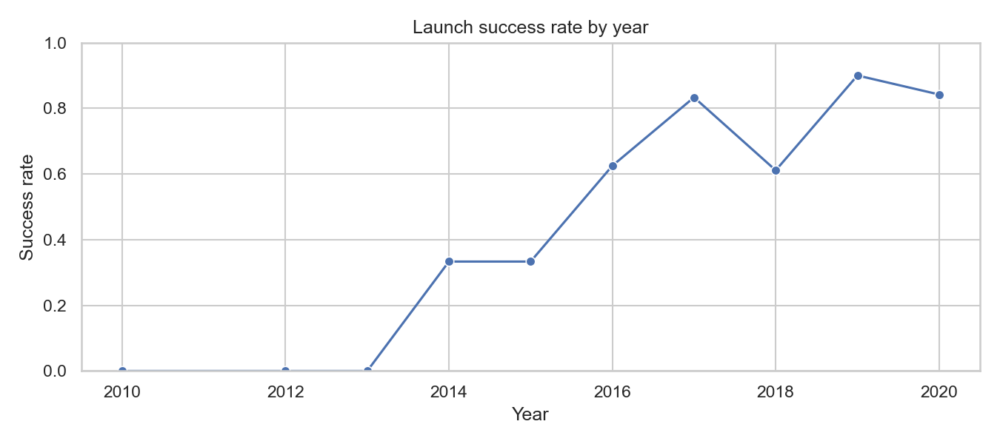
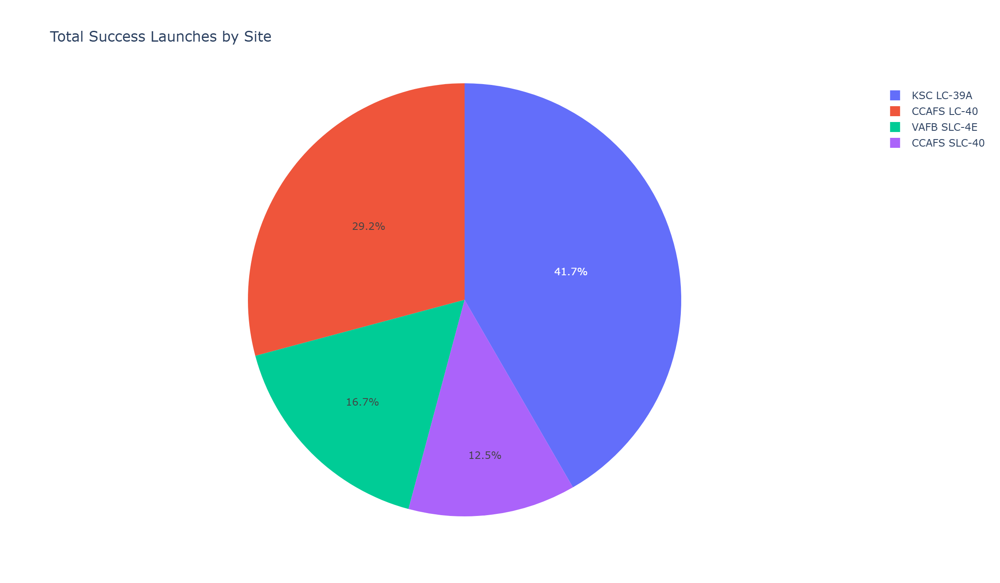

# SpaceX Falcon 9: predicting whether the first stage lands

Capstone project for IBM's *Applied Data Science Capstone* (IBM Data Science Professional Certificate). The scenario: a new launch provider, "SpaceY", wants to price its launches against SpaceX, whose price advantage comes from reusing the first stage. If you can predict whether the first stage lands, you can estimate what a launch really costs.

The project covers the whole workflow: collect data from an API and from Wikipedia, clean it, explore it with SQL, charts and an interactive map, build a Plotly Dash dashboard, and compare four classifiers.



## Data

| Source | What came out |
|---|---|
| SpaceX REST API (`01_data_collection_api`) | 90 Falcon 9 launches with booster, payload mass, orbit, launch site, landing outcome, reuse, legs and grid fins (`data/spacex_launches_clean.csv`) |
| Wikipedia launch tables, BeautifulSoup (`02_web_scraping`) | 121 launch records (`data/spacex_webscraping.csv`) |
| Wrangling (`03_data_wrangling`) | a binary landing label from the eight outcome types; 60 of the 90 launches landed (66.7%) |
| One-hot encoding for modelling | 80 features (`data/spacex_features_with_dummies.csv`) |

## Exploration

- **SQL** (`04_eda_sql`, SQLite): launch sites, payload totals and averages by customer and booster, first successful ground-pad landing, outcome counts by period.
- **Charts** (`05_eda_visualization`): flight number and payload against launch site and orbit; no first stage landed before 2014, a third did in 2014–15, and 84–90% did in 2019–20 (with a dip to 61% in 2018).
- **Map** (`06_launch_sites_folium`): every launch site with its successes and failures, and distances to the nearest coast, railway, highway and city. Open `figures/launch_sites_map.html` in a browser.
- **Dashboard** (`dashboard/spacex_dash_app.py`, Plotly Dash): a site dropdown and payload slider driving a success pie chart and a payload-versus-outcome scatter. KSC LC-39A has the best record in the dashboard data, 10 landings out of 13 launches (77%).



## Models

Logistic regression, SVM, decision tree and k-nearest neighbours, each tuned with `GridSearchCV` (10-fold) on standardised features, then scored on a held-out test set of 18 launches.

| Model | Best parameters | CV accuracy | Test accuracy |
|---|---|---|---|
| Logistic regression | C = 0.01, L2 | 0.846 | **0.833** |
| SVM | sigmoid kernel, C = 1.0 | 0.848 | **0.833** |
| k-nearest neighbours | k = 10, Manhattan distance | 0.848 | **0.833** |
| Decision tree | entropy, max depth 18 | 0.886 | 0.778 |

Three models tie at 15 of 18 test launches. The decision tree has the best cross-validation score and the worst test score, which is overfitting on a small dataset. With 18 test launches, one launch moves accuracy by 5.6 points, so the honest conclusion is that any of the three simpler models will do, and logistic regression is the easiest to explain. The confusion matrices in `07_landing_prediction_ml` show the remaining errors are false positives: launches predicted to land that did not.

## The presentation

`presentation/SpaceY_First_Stage_Landing_Prediction.pdf` is the final report: executive summary, methodology, results for each step and conclusions.

## Run it

```bash
pip install pandas numpy requests beautifulsoup4 lxml matplotlib seaborn folium plotly dash scikit-learn jupyter
jupyter notebook notebooks/          # run 01 to 07 in order
python dashboard/spacex_dash_app.py  # http://127.0.0.1:8050
```

## History

Built in August 2025 on another GitHub account and moved here in October 2026. This repository keeps the final version of each notebook, the dashboard, the outputs and the final presentation; the drafts and earlier revisions stayed behind.

---

Omar Essam El Sherbiny · [omaressam.web.app](https://omaressam.web.app) · [LinkedIn](https://www.linkedin.com/in/omar-essam-el-sherbiny-b602279b/)
